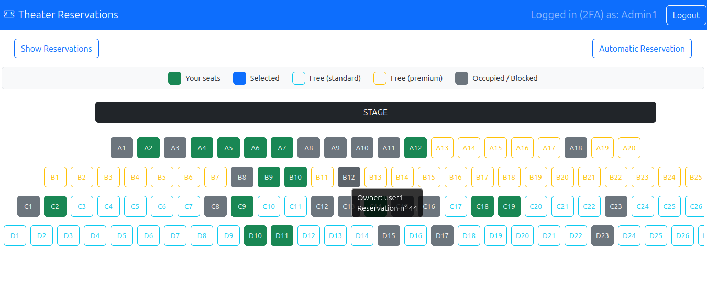
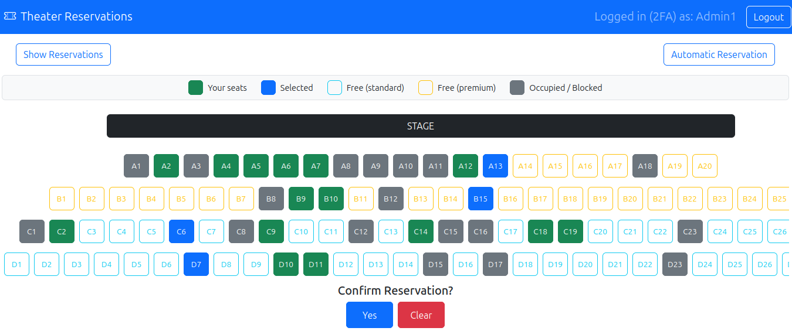
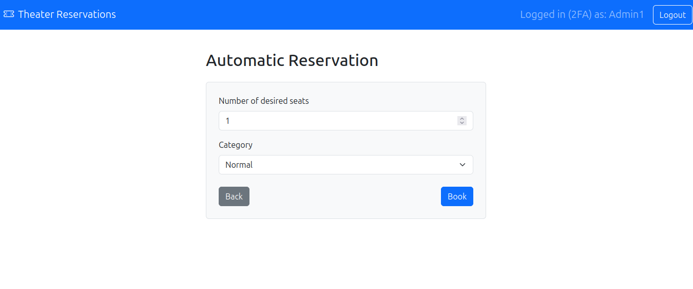
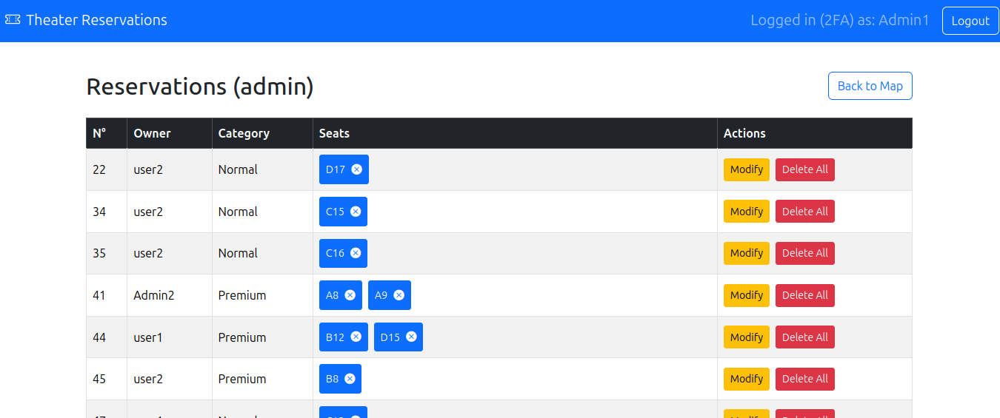
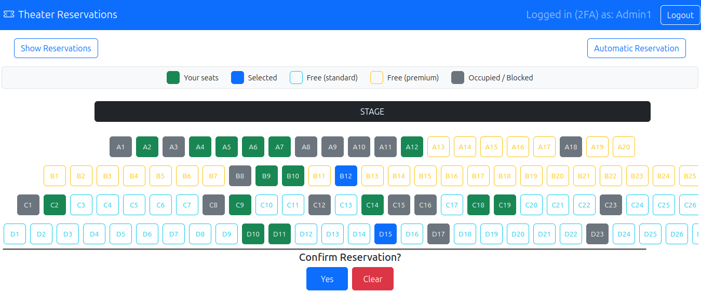

# Exam #1: "Theater"
## Student: s353944 - Riccardo Naldini

## React Client Application Routes

- Route `/`: Home page, shows the interactive theater map with all seats. Logged-in users can select free seats to make a manual reservation.
- Route `/login`: Login page, handles the authentication flow (both the initial credentials form and the subsequent TOTP verification). After a successful login, the user is redirected to the main route (`/`).
- Route `/automatic-reservation`: Page containing a form that allows logged-in users to request a specific number of seats of a certain category to be assigned automatically.
- Route `/reservations`: Shows the table of active reservations. Normal users see only their own reservations, while admins (who authenticated via TOTP) can view and manage all reservations.
- Route `*`: Page for non-existing URLs that redirects to the home page.

## API Server

### Session Management

* **POST `/api/sessions`**: Authenticate and login the user.
  - **Request body**: JSON object with email and password:
    ```json
    { "username": "user1@p.it", "password": "password" }
    ```
  - **Response body**: JSON object with the user's info, or a description of the error:
    ```json
    { "id": 3, "username": "user1@p.it", "name": "user1", "canDoTotp": false, "isTotp": false }
    ```
  - Codes: `200 OK`, `401 Unauthorized` (incorrect credentials), `500 Internal Server Error`.

* **POST `/api/login-totp`**: Perform the 2FA through TOTP.
  - **Request body**: JSON object with the generated code:
    ```json
    { "code": "123456" }
    ```
  - **Response body**: JSON object indicating authorization status:
    ```json
    { "otp": "authorized" }
    ```
  - Codes: `200 OK`, `400 Bad Request`, `401 Unauthorized` (incorrect code), `503 Service Unavailable`.

* **GET `/api/sessions/current`**: Get info on the logged in user.
  - **Response body**: JSON object with the same info as in login:
    ```json
    { "id": 3, "username": "user1@p.it", "name": "user1", "canDoTotp": false, "isTotp": false }
    ```
  - Codes: `200 OK`, `401 Unauthorized`.

* **DELETE `/api/sessions/current`**: Logout the user.
  - **Response body**: Empty JSON object on success: `{}`
  - Codes: `200 OK`, `401 Unauthorized`.

### Interaction with DB

* **GET `/api/seats`**: Get the entire map of seats and their status.
  - **Response body**: JSON array of seat objects (unregistered users will not see `reservationId`, `ownerID`, `releasedBy`, and `releasedAt`):
    ```json
    [ 
      { "id": 1, "rowLabel": "A", "seatNumber": 1, "category": "premium", "reservationId": 10, "ownerID": 3, "releasedBy": null, "releasedAt": null, "ownerName": "user1", "reserved": true }, ... 
    ]
    ```
  - Codes: `200 OK`, `500 Internal Server Error`.

* **GET `/api/reservations`**: Get the reserved seats for the current user (or all reserved seats if admin with TOTP).
  - **Response body**: JSON array of seat objects:
    ```json
    [ 
      { "id": 35, "rowLabel": "C", "seatNumber": 12, "category": "normal", "reservationId": 3, "ownerID": 3, "releasedBy": null, "releasedAt": null, "ownerName": "admin2", "reserved": false }, ... 
    ]
    ```
  - Codes: `200 OK`, `401 Unauthorized`, `500 Internal Server Error`.

* **POST `/api/reservations`**: Create a new reservation for the logged in user.
  - **Request body**: JSON object for manual selection (array of seat IDs) OR automatic assignment (`numSeats` and `category`):
    ```json
    { "seats": [15, 16] } 
    ```
    *or*
    ```json
    { "numSeats": 3, "category": "premium" }
    ```
  - **Response body**: JSON object with the generated reservation ID and the array of booked seats IDs, or error description:
    ```json
    { "reservationId": 5, "bookedSeats": [15, 16] }
    ```
  - Codes: `201 Created`, `400 Bad Request`, `401 Unauthorized`, `403 Forbidden`, `422 Unprocessable Entity`, `500 Internal Server Error`.

* **PUT `/api/reservations/:id`**: Update an existing reservation by adding or removing seats.
  - **Request body**: JSON object with arrays of seat IDs to add and/or remove:
    ```json
    { "seatsToAdd": [25], "seatsToRemove": [15] }
    ```
  - **Response body**: Empty on success, or JSON object with error description.
  - Codes: `204 No Content`, `400 Bad Request`, `401 Unauthorized`, `403 Forbidden`, `404 Not Found`, `422 Unprocessable Entity`, `500 Internal Server Error`.

* **DELETE `/api/reservations/:id`**: Delete a specific reservation.
  - **Response body**: Empty on success.
  - Codes: `204 No Content`, `401 Unauthorized`, `404 Not Found`, `422 Unprocessable Entity`, `500 Internal Server Error`.

## Database Tables

| Table Name | Field Name | Data Type | Constraints / Foreign Keys |
|---|---|---|---|
| **users** | `id` | INTEGER | PRIMARY KEY AUTOINCREMENT |
| | `email` | TEXT | NOT NULL, UNIQUE |
| | `name` | TEXT | |
| | `hash` | TEXT | NOT NULL |
| | `salt` | TEXT | NOT NULL |
| | `secret` | TEXT | |
| | `lastTOTPStep` | INTEGER | |
| | `isAdmin` | INTEGER | NOT NULL |
|||||
| **reservations** | `id` | INTEGER | PRIMARY KEY AUTOINCREMENT |
| | `user_id` | INTEGER | NOT NULL, FOREIGN KEY references `users(id)` |
|||||
| **seats** | `id` | INTEGER | PRIMARY KEY AUTOINCREMENT |
| | `row_label` | TEXT | NOT NULL |
| | `seat_number` | INTEGER | NOT NULL |
| | `reservation_id` | INTEGER | FOREIGN KEY references `reservations(id)` |
| | `released_by` | INTEGER | FOREIGN KEY references `users(id)` |
| | `released_at` | TEXT | |

## Main React Components

- `App` (in `App.jsx`): The main application component. It handles the routing structure and maintains the global authentication state (`user`, `loggedIn`, `loggedInTotp`, `modifyingState`).
- `TheatreMap` (in `Theatre.jsx`): Renders the theater's grid layout, the color legend, and the action buttons. It manages the state of the currently selected seats and submits manual booking or modification requests.
- `Seat` (in `Theatre.jsx`): Represents a single seat button in the map. It dynamically determines its own appearance (color, disabled state, tooltip text) based on its status (free, occupied, selected, or owned by the current user).
- `AutomaticReservationRoute` (in `Theatre.jsx`): Renders the form allowing users to input the desired number of seats and the category (standard or premium) for an automatic reservation.
- `ReservationsTable` (in `ReservationTable.jsx`): Fetches and displays reservations in a table format. It groups individual seats by their `reservationId` and provides action buttons to modify or delete entire reservations (or single seats).
- `LoginWithTotp` (in `App.jsx`): A wrapper component acting as a router for the authentication phase. It decides whether to render the standard login form or the TOTP form based on the user's progress.
- `LoginForm` (in `Auth.jsx`): The standard login form requesting email and password.
- `TotpForm` (in `Auth.jsx`): The second-factor authentication form, requesting the 6-digit TOTP code for admin users.

## Screenshot
Theatre Map with colour legend for distinguishing between seats:


Every seat has a tooltip containing the owner and the reservation ID. Admins can see the tooltips of all the places (also those that do not belong to them) while normal user can only see the tooltip of the seats they possess.

Manual creation of a reservation (look at blue seats that are those selected):


Automatic Reservation form:


Table resuming the reservations of all the users (we are logged as admin):


Note that:
- If we were logged as normal user we would see **only** our reservations;
- The table allows to delete single seats from a reservation. In case of the deletion of the last seat, the **whole reservation** is deleted from the DB;
- The `Delete All` Button updates the `seats`table and deletes the corresponding row in `reservations` table;
- The `Modify` button allows to modify a specific reservation.

Modify action:


`B12` and `D15` are the places that belongs to the reservation we want to modify. They are already selected. 

## Users Credentials

| name | email | password | 
|-------|-------|----------|
| admin1 | admin1@p.it | pwd |
| admin2 | admin2@p.it | pwd |
| user1 | user1@p.it | pwd | 
| user2 | user2@p.it | pwd |

The `salt` (16 characters) and the hashed value of the password `pwd` (32 characters) have been generated through the web sites indicated by the `.pdf` file regarding `lab13-authentication`.

Passwords for simple authentication has been intentionally chosen short, simple and equal for all the users to facilitate testing. It's not necessary to emphasize the danger of such a practice in a real-world scenario.
